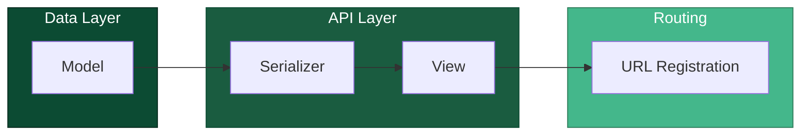

# Feature creation workflow

This guide shows a generic and simple workflow for creating features with the 
[django rest framework](https://www.django-rest-framework.org/api-guide/requests/) 
by utilizing the class ModelViewSet.

## Contents
1. [General Idea (Concept)](#1-general-idea-concept)
2. [Complex Example](#2-complex-example)

## 1. General Idea (Concept)

To build from the ground up we use django's [ORM](https://en.wikipedia.org/wiki/Object%E2%80%93relational_mapping) 
implementation as foundation for every development iteration. The following is a visualization of which parts to 
implement in order.



The parts to implement answer the following questions: 

1. Data Model - Which attributes are store persistently and in which format.
2. Serializer - Which attributes are output and which is he able to input. 
3. View - What action can be executed on which data.
4. Url Registration - At what "Address" can the actions be accessed.

## 2. Complex Example

### Models

The following shows a simple lottery ticket and draw model. The ticket could also be named "Entry" as a lottery ticket 
usually refers to a draw entry. Both share common attributes which are centralized in the Common model.

`/api/models/CommonModel.py`
```Python
import uuid
from django import models

class Common(models.Model):
    id = models.UUIDField(unique=True, primaryKey=True, default=uuid.uuid4, editable=True)
    created_at = models.DateTimeField(auto_now_add=True, blank=True)
    created_by = models.ForeignKey(
        settings.AUTH_USER_MODEL,
        on_delete=models.SET_NULL,
        null=True,
        related_name="created_%(class)s",
    )
```

`/api/models/Lottery_TicketModel.py`
```Python
from django import models
from api.models import Common

class Ticket(Common):
    valid_until = models.DateTimeField()

    def __str__(self):
        return f"Ticket {self.id} of {self.created_by}"
```

`/api/models/DrawModel.py`
```Python
from django import models
from api.models import Common

class Draw(Common):
    end_date = models.DateTimeField()
    winnerTicket = ForeignKey(
        Ticket,
        on_delete=models.SET_NULL,
        null=True,
        related_name="won_draw",
    )
    
    def __str__(self):
        if self.winnerTicket:
            return f"Draw {self.id} won by {self.winnerTicket}"
        return f"Draw {self.id}"
```

### Serializers

`/api/serializers/Lottery_TicketSerializer.py`
```Python
from django.utils import timezone
from rest_framework import serializers
from api.models import Ticket, Draw

class TicketSerializer(serializers.ModelSerializer):
    
    class Meta:
        model = Ticket
        fields = [
            "valid_until",
            "created_by",
            "created_at",
        ]
        read_only_fields = [
            "id",
            "created_at",
            "created_by",
            "valid_until"
        ]
    
    def validate(self, attrs):
        """
        Expects an authenticated user to make requests when using this serializer. Use this serializer like this ``
        """
        user = self.context["request"].user
        now = timezone.now()
        
        # Get the latest "running" draw (end date in the future)
        latest_draw = (
            Draw.objects
            .filter(end_date__gt=now)
            .order_by("-created_at")
            .first()
        )
        # Get the latest valid ticket for the user (valid until date in the future)
        latest_valid_ticket = (
            Ticket.objects
            .filter(created_by=user, valid_until__gt=now)
            .order_by("-created_at")
            .first()
        )
        
        # 1. Validation case: A draw and a ticket exists thus the ticket is soft (context) bound the draw
        if latest_draw and latest_valid_ticket:
            raise serializer.ValidationError("You can create tickets for a draw once")
            
        # 2. validation case: The ticket is not used but it is still valid (only one valid ticket constraint)
        if latest_valid_ticket:
            raise serializer.ValidationError("You already have a valid ticket")
            
        return attrs
            
    def create(self, validated_data):
        # Auto set context values on creation
        validated_data["created_by"] = self.context["request"].user
        return attrs
```

`/api/serializers/Lottery_DrawSerializer.py`
```Python
from rest_framework import serializers
from api.models import Draw

class DrawSerializer(serializers.ModelSerializer):
    class Meta:
        model = Draw
        fields = [
            "winnerTicket",
            "end_date",
            "created_at",
        ]
        read_only_fields = [
            "id",
            "created_at",
            "created_by",
            "end_date",
            "winnerTicket",
        ]
    
    def validate(self, attrs):
        # Get the end_date from unserialized data
        end_date = attrs["end_date"]
        if not end_date:
            # Will be picked up by end_date data definition an throw ValidationError it's self
            return attrs
        
        # Define blank space left and right (3 weeks before and after a draw ends there sould be no other draw)
        cutoff_left = end_date - timedelta(weeks=3)
        cutoff_right = end_date + timedelta(weeks=3)
    
        # Get the first conflicting object
        conflict = (
            Draw.objects
            .filter(end_date__gt=cutoff_left, end_date__lt=cutoff_right)
            .exclude(pk=self.instance.pk if self.instance else None)
            .order_by("-end_date")
            .first()
        )
        
        # If one exits raise error
        if conflict:
            raise serializer.ValidationError(f"Between two draw have to bee 3 weeks.")
       
        return attrs
```

### ViewSets

`/api/views/Lottery_TicketViewSet.py`
```Python
from rest_framework.viewsets import ModelViewSet
from api.serializers import TicketSerializer

class TicketViewSet(ModelViewSet):
    serializer_class = TicketSerializer
    permission_classes = [IsAuthenticated]
    
    def get_qeuryset(self):
        return Ticket.objects.filter(created_by=self.request.user)
```

`/api/views/Lottery_DrawViewSet.py`
```Python
from rest_framework.viewsets import ModelViewSet
from api.serializers import DrawSerializer
from api.access_policy import IsSuperuser

class DrawViewSet(ModelViewSet):
    serializer_class = DrawSerializer
    permission_classes = [IsSuperuser]
    
    @action(
        detail=True, 
        url_path="draw_winner", 
        methods=["post"], 
        permission_classes=[IsSuperuser]
    )
    def draw_winner_action(self, request, pk=None):
        ...
```

Rest Framework ViewSets have to be registered with the rest_framework router.

`/api/urls.py`
```Python
from api.views import DrawViewSet, TicketViewSet
...
router.register(r"lottery/draws", DrawViewSet, basename="lottery-draws")
router.register(r"lottery/tickets", TicketViewSet, basename="lottery-tickets")
...
```
